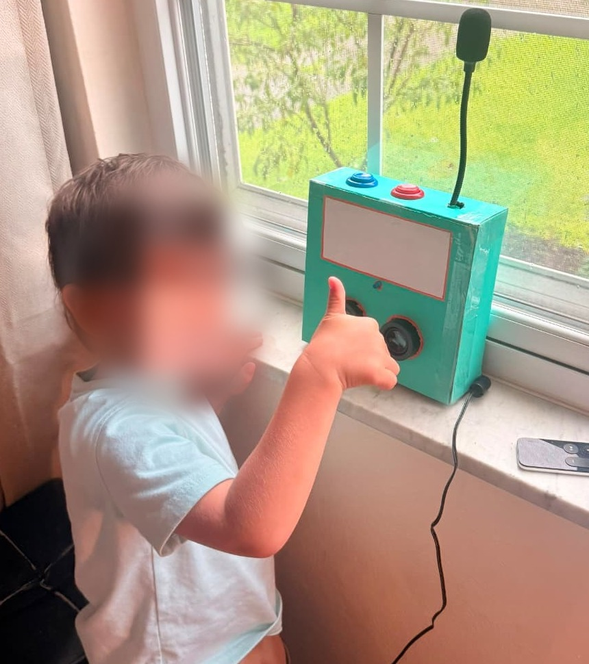
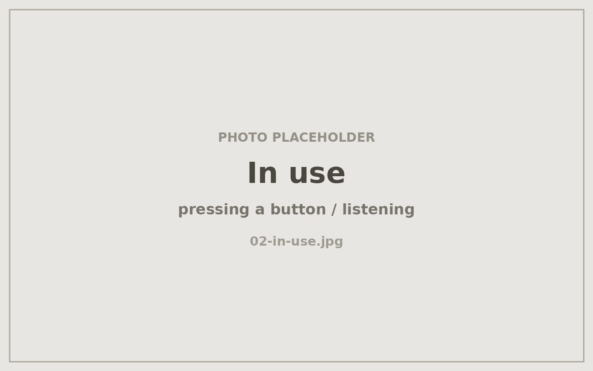
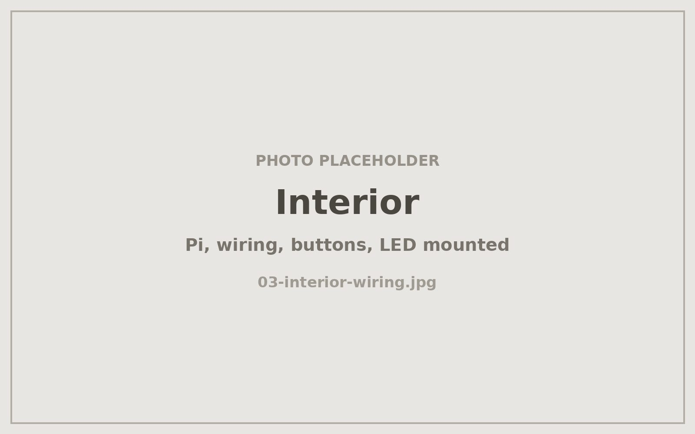

# Robotalk — a screenless voice-message box for my son

A two-button, one-LED wooden box that swaps WhatsApp voice notes with our family
group. No screen, no menus, no phone: press and hold the red button to talk,
tap the blue one to hear what came back. Built as a weekend hardware project
to entertain my preschooler — and as an exercise in making software run on
hardware it was never designed for.

<!-- PHOTO: hero shot — the finished box, buttons and LED visible, ideally in your son's hands -->

---

## What this repository is

This repo is **my build log and hardware port**, not the application.

The box runs the open **Cajita mágica** kit by Salomón Zarruk ("Aztec") —
[zarruk/cajita-magica-aztec](https://github.com/zarruk/cajita-magica-aztec) — which
provides the Node.js application, the WhatsApp integration, and the local
control PWA. That code is his, is published without a reuse license, and is
**not reproduced here**. Go get it from him.

What *is* here is everything I had to work out myself, because I built the box
on the wrong computer on purpose:

| | Kit specifies | What I actually used |
|---|---|---|
| Board | Raspberry Pi 5, 2 GB | **Raspberry Pi 2 Model B v1.1** — 1 GB RAM, 32-bit ARMv7 |
| OS | Raspberry Pi OS Lite, 64-bit | **Raspberry Pi OS Lite, 32-bit** (forced by ARMv7) |
| Networking | Onboard WiFi | **USB WiFi adapter** (the Pi 2 has none) |
| Power | Official 27 W USB-C | **5 V micro-USB** |
| Audio out | 5HV2 USB sound card | **Pi's onboard 3.5 mm jack** (ALSA card `Headphones`) |
| Audio in | USB-carded analog mic | **CMTECK USB microphone** (ALSA card `CMTECK`, capture only) |

Half the specification, a different CPU architecture, and a different audio
topology. The kit's documentation, install script, and verification script all
assume the supported build, so each of those substitutions had to be diagnosed
and fixed rather than configured.

Result: **the box works and starts on its own after a power cut.** Assembled
2026-08-15; still running.

---

## Why I built it

My son is too young for a phone and too young to read, but not too young to
want to talk to people who aren't in the room. A box with two buttons is an
interface he already understands — press it, something happens, a light comes
on when there's something waiting for him.

The engineering appeal was the opposite of the usual homelab exercise. Instead
of throwing capable hardware at a problem, I took a capable project and pushed
it down onto a 2015 single-board computer sitting in a drawer, to see where it
would break. It broke in three interesting places, documented below.

<!-- PHOTO: your son using the box — pressing a button, or listening -->

---

## How it works

<!-- PHOTO: interior shot — Pi, wiring, buttons and LED mounted in the enclosure -->

- **Red button (hold)** — records while held, plus a trailing second after
  release, then sends the clip as a WhatsApp voice note to one authorized
  family group.
- **Blue button (tap)** — plays the oldest unheard message and clears the LED.
- **Blue button (hold)** — plays every pending message in order.
- **LED** — lit when something is waiting; blinks during activity.
- **systemd service** — starts the app at boot, restarts it on failure, and
  brings the box back up unattended after a power loss.
- **Local web PWA** — the family-facing config and mailbox view, reachable on
  the LAN. Everything stays on the box; nothing goes to a third-party server
  except WhatsApp itself.

Detailed notes live in `docs/`:

- [`docs/hardware-port.md`](docs/hardware-port.md) — the substitutions above, and what each one cost
- [`docs/wiring.md`](docs/wiring.md) — GPIO pin map, resistor, LED polarity
- [`docs/audio-alsa.md`](docs/audio-alsa.md) — the ALSA configuration that made a split playback/capture setup stable
- [`docs/runbook.md`](docs/runbook.md) — operating and recovery procedures

---

## Three things that broke

### 1. Audio died on reboot, and only on reboot

**Symptom:** playback worked perfectly, then after a restart every attempt
failed with `audio open error: Unknown error 524`.

**Cause:** ALSA card *numbers* are enumeration order, not identity. On reboot
the Pi's HDMI output claimed card 0, so a config pinned to `plughw:0,0` was
addressing an HDMI device that cannot be opened with no monitor attached.

**Fix:** address cards by **name**, never by number, and split playback from
capture explicitly with an `asym` PCM — the onboard jack for output, the USB
mic for input. Full config in [`docs/audio-alsa.md`](docs/audio-alsa.md).

The lesson generalizes well past this project: any device path that's really an
enumeration index is a latent reboot bug.

### 2. The audio config vanished twice

**Symptom:** a working box that lost its audio setup entirely, twice, with no
one having touched it.

**Cause:** the config lived in `~/.asoundrc`, and the box was being unplugged
at the wall. Recent writes hadn't reached the microSD.

**Fix:** move it to `/etc/asound.conf` (system-wide, written once, not
rewritten per session), call `sync` after writing it, and treat
`sudo poweroff` as the only acceptable way to turn the box off. A toy in a
child's room is going to get unplugged, so durability of on-disk state is a
design requirement, not an operational nicety.

### 3. The box beeped forever

**Symptom:** a beep every few seconds, indefinitely, and the box neither sent
nor played anything.

**Cause:** this one was a nice bit of misdirection. The beep is the app's
*startup* tone. WhatsApp had invalidated the linked-device session; the app was
failing on launch, systemd was restarting it five seconds later, and each
restart played the startup tone. The "beeping" was a crash loop being heard
rather than read.

**Fix:** stop the service to break the loop, back up the auth directory, clear
the dead session, re-link the dedicated line, reset the systemd failure counter,
restart. Tested and verified 2026-09-01. Step-by-step in
[`docs/runbook.md`](docs/runbook.md).

I also traced the kit's persistent volume-control warning to a hardcoded ALSA
card name in its source that doesn't exist on this hardware — a harmless false
positive here, but it masks the real failure mode above, so the runbook says so
explicitly.

---

## What I'd do differently

- **Use a supported board.** The port was the point, but 1 GB of RAM on a
  32-bit userland is a permanent tax: no headroom, slower npm installs, and a
  memory ceiling I still monitor.
- **Design for the power cord being yanked.** I got there eventually; it should
  have been the first assumption.
- **Add a hardware power button.** The single most useful missing part, because
  the correct shutdown procedure is currently a command over SSH.

---

## A note on the WhatsApp dependency

The kit uses [Baileys](https://github.com/WhiskeySockets/Baileys), an
unofficial WhatsApp library. It can stop working whenever WhatsApp changes, and
there is a real risk of the linked number being blocked. The box therefore runs
on a **dedicated physical line**, never a personal number, and is scoped to a
single authorized group chat. Anyone building one should understand that
tradeoff before they start.

No credentials, session data, group identifiers, mailbox audio, or family
recordings appear in this repository.

---

## Credits

The application, the WhatsApp integration, the control PWA, and the original
assembly course are the work of **Salomón Zarruk ("Aztec")** —
[zarruk/cajita-magica-aztec](https://github.com/zarruk/cajita-magica-aztec).
Thank you for publishing it. The hardware port, the ALSA work, the wiring, the
failure analysis, and the runbook in this repository are mine.

## License

The documentation in this repository is released under
[CC BY 4.0](LICENSE); the configuration and shell snippets are under
[MIT](LICENSE-CODE). Neither covers the upstream application, which remains
under its author's rights.
