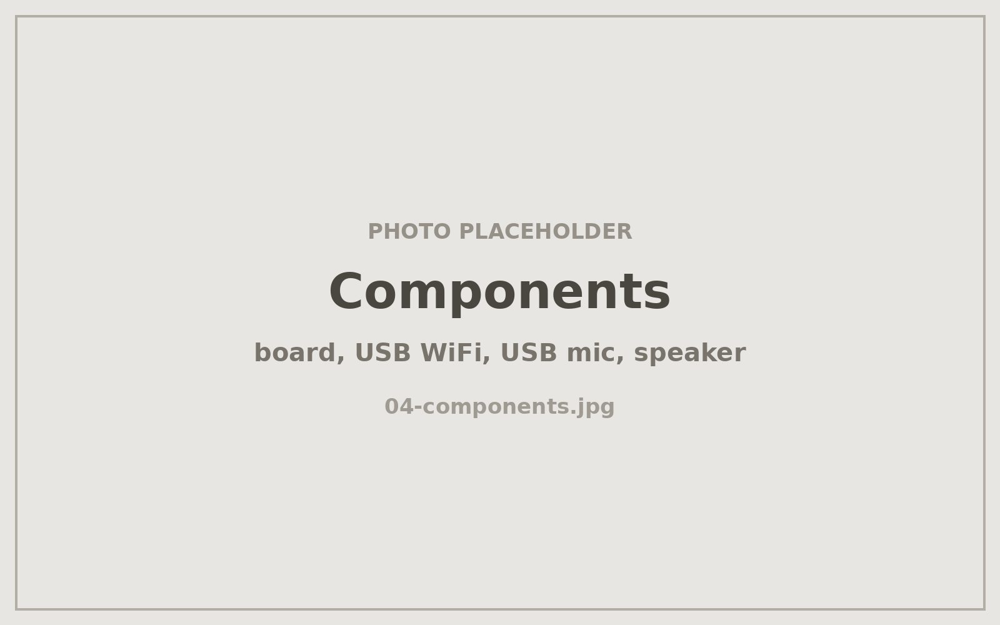

# Hardware port: running the kit on a Raspberry Pi 2 Model B

The upstream **Cajita mágica** kit targets a Raspberry Pi 5 with 2 GB of RAM, a
64-bit OS, onboard WiFi, USB-C power, and a specific USB sound card. I built it
on a Raspberry Pi 2 Model B v1.1 that was already in a drawer. Every line below
is a deviation that had to be worked out rather than followed.

> These substitutions are **not** validated by the upstream course. If you ask
> its author for support, say up front that you are not on the supported build.

## Substitutions

| Element | Kit specifies | Used here | Consequence |
|---|---|---|---|
| Board | Raspberry Pi 5, 2 GB | Raspberry Pi 2 Model B v1.1, 1 GB | Half the RAM; ARMv7 instead of ARMv8 |
| OS image | Raspberry Pi OS Lite 64-bit | Raspberry Pi OS Lite **32-bit** | Mandatory — v1.1 cannot run 64-bit |
| Networking | Onboard WiFi | USB WiFi adapter | One more USB device to keep powered and named |
| Power | Official 27 W USB-C supply | 5 V micro-USB supply | Watch for undervoltage with mic + WiFi both drawing |
| Audio out | 5HV2 USB sound card | Onboard 3.5 mm jack (`Headphones`) | Quieter output; needs an explicit mixer level |
| Audio in | Analog mic via USB card | CMTECK USB microphone (`CMTECK`) | Capture-only device, so playback and capture live on **different** cards |

## Why each one mattered

**32-bit userland.** The Pi 2 v1.1 is ARMv7; the 64-bit image will not boot. Any
instruction, prebuilt binary, or npm package that assumes `aarch64` needs a
32-bit equivalent, so budget extra time for native module builds.

**Split audio devices.** This is the substitution with the widest blast radius.
The kit assumes one USB sound card handling both directions. Here, output is the
Pi's onboard jack and input is a separate USB microphone — two ALSA cards, which
requires an asymmetric default PCM rather than a single device. See
[`audio-alsa.md`](audio-alsa.md).

**Card naming.** With a USB WiFi adapter, a USB mic, and onboard HDMI plus
analog audio all enumerating at boot, card *numbers* are not stable across
restarts. Everything must be addressed by name.

**1 GB of RAM.** No fix, just monitoring. If the box hangs or reboots on its
own, check memory pressure first:

```bash
free -h
sudo journalctl -u messagebox -n 100 --no-pager
```

**Undervoltage.** A micro-USB supply feeding a Pi plus two USB peripherals is
close to the edge. Worth checking if behaviour gets flaky:

```bash
vcgencmd get_throttled    # 0x0 means no undervoltage events
```

## Upstream verification script: expected false positives

The kit ships a verification script written against the supported hardware. On
this build it reports two warnings that are **not** faults:

1. **`no aparece la tarjeta de audio Device`** — it looks for an ALSA card
   literally named `Device` (the 5HV2). Here the cards are `Headphones` and
   `CMTECK`. Expected.
2. **`servicio no está activo`** — only appears when the service has been
   deliberately stopped for manual testing.

A third recurring warning about ALSA volume not applying comes from a hardcoded
card name in the application's source. It is cosmetic — playback is unaffected —
but it appears on every start, so it must not be mistaken for the cause when
audio genuinely fails. Set volume manually instead
([`audio-alsa.md`](audio-alsa.md)).

<!-- PHOTO: the board and peripherals before assembly — Pi 2, USB WiFi, USB mic, speaker -->

