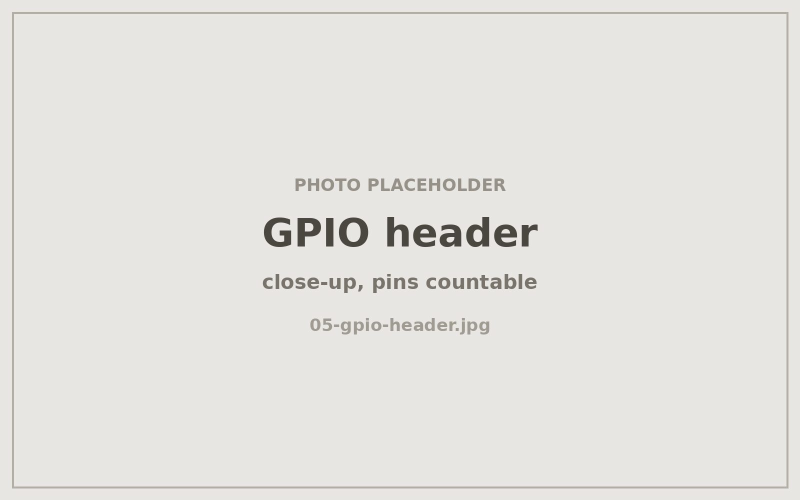
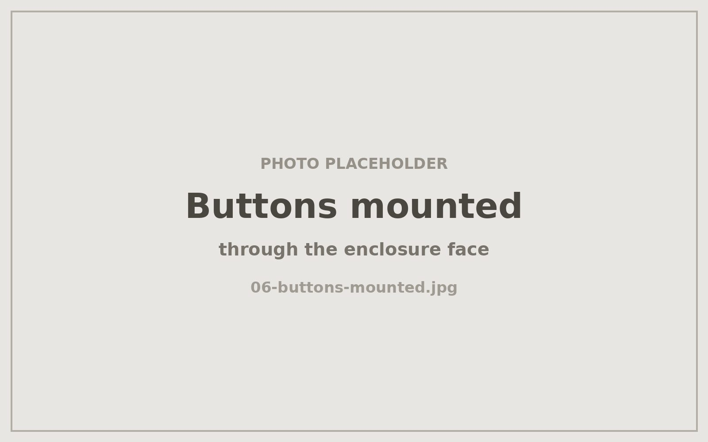

# Wiring

Two momentary pushbuttons and one LED on the Raspberry Pi 2's 40-pin header.
Pin numbers below are **physical** board pins, with the BCM/GPIO name given for
the signal lines.

| Element | Signal | Ground |
|---|---|---|
| TALK button (red) | pin 11 — GPIO17 | pin 9 — GND |
| LISTEN button (blue) | pin 13 — GPIO27 | pin 14 — GND |
| LED | long leg → pin 15 — GPIO22 | short leg → 330 Ω resistor → pin 20 — GND |

Buttons are wired straight to ground and read with the Pi's internal pull-ups —
no external resistors needed on those two. The LED needs its 330 Ω series
resistor.

<!-- PHOTO: close-up of the GPIO header with jumpers attached, pins countable -->


## Gotchas

**LED polarity.** My first attempt had the LED in backwards and it simply never
lit — no error, no clue in the logs, because the GPIO write succeeds either way.
Long leg (anode) goes to GPIO22; short leg (cathode) goes through the resistor
to ground. If the software reports `LED_ON` and nothing happens, flip the LED
before debugging anything else.

**The LISTEN button prints nothing on press.** It reports only on release. That
is correct: the app has to wait to distinguish a tap (play one message) from a
hold (play the whole queue). A silent press is not a dead button.

**Stop the service before manual GPIO tests.** Two processes cannot own the same
pins or port:

```bash
sudo systemctl stop messagebox
```

Skipping this produces `lgpio.error: 'GPIO busy'` and
`EADDRINUSE: address already in use :::8080`.

## Verified behaviour

After wiring, both buttons and the LED were confirmed end to end: press and
release events on each button, hold detection on LISTEN, and LED on / blink /
off. Then the full path: hold TALK → voice note arrives in the family group;
message arrives → alert tone plays and LED lights; tap LISTEN → message plays
and LED clears; hold LISTEN → queued messages play in order.

<!-- PHOTO: the two buttons and LED mounted through the enclosure face -->

